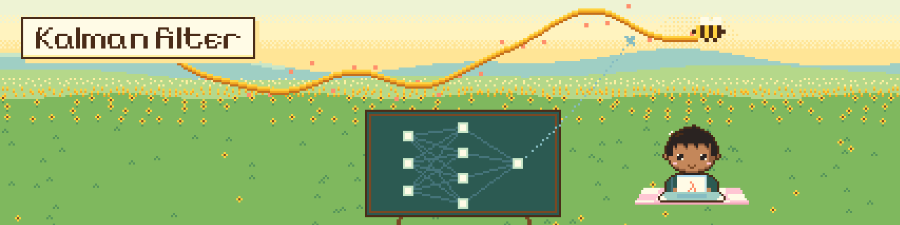

<p align="center"></p>

# Kalman filter

Kalman filter notebooks and data for the IEEE ICONAT 2022 paper on a neural-network-aided Kalman filter.

[MIT licence](LICENSE)

The paper improves a Kalman filter's accuracy by feeding it values estimated by a pre-trained neural network. This repository holds the Kalman filter side: notebooks that build up the filter from one dimension, a synthetic data generator and the filter applied to that data.

**Published:** IEEE conference paper, 2022 International Conference for Advancement in Technology (ICONAT), pp. 1–4. DOI: [10.1109/ICONAT53423.2022.9726059](https://doi.org/10.1109/ICONAT53423.2022.9726059). The paper PDF is in this repository.

## Why it is interesting

- `Kalman Theory/` explains the filter from first principles: noisy sensor readings as Gaussians, scaling a Gaussian, and the predict and update steps for a car moving in one dimension, first linear and then non-linear.
- `Research Code/` generates a ground-truth motion profile (acceleration, velocity, position), adds sensor noise, and then filters speed and position with the acceleration as the control input, plotting the estimate against the truth.

The neural network described in the paper is not in this repository.

## Run it

```bash
pip install numpy matplotlib scipy jupyter
jupyter notebook
```

Open `Kalman Theory/1D.ipynb` for the walkthrough. For the experiment, run `Research Code/Sample Data Generation.ipynb` first: it writes the `data.json` and `data_orig.json` files that `Implementing the improved Kalman Filter.ipynb` reads.

## Tech

Python, NumPy, SciPy, Matplotlib, Jupyter.

## Context

Research project at VIT Vellore, a collaboration between Computer Science and Engineering and Communication Engineering, published in January 2022. The full author list is in the citation below.

## Cite

```bibtex
@inproceedings{Agarwal2022Kalman,
  title     = {Neural Network Aided Kalman Filter to Maximize Accuracy},
  author    = {Agarwal, Varun Niraj and Kanshi, Avaneesh and Melarkode, Navneet Vinod and Krishna, Hemanth and Hota, Malaya Kumar},
  booktitle = {2022 International Conference for Advancement in Technology (ICONAT)},
  publisher = {IEEE},
  year      = {2022},
  pages     = {1--4},
  doi       = {10.1109/ICONAT53423.2022.9726059}
}
```

GitHub also reads `CITATION.cff` and shows a "Cite this repository" button.

## Status

Finished, as of 26 November 2026. The paper was published at ICONAT 2022. See [STATUS.md](STATUS.md).

## Licence

MIT, see LICENSE.
